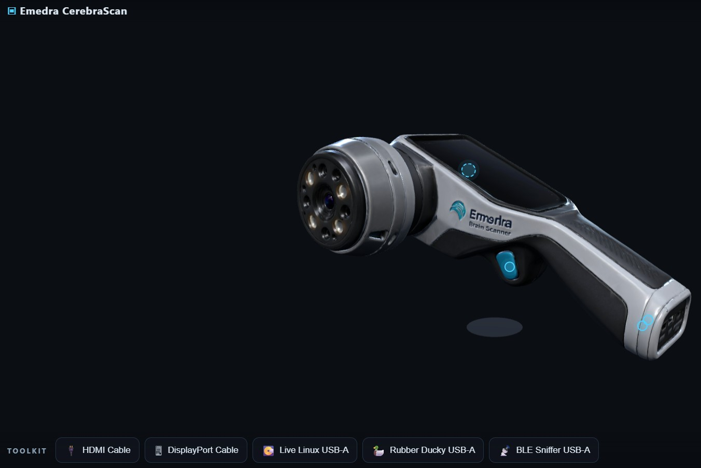

# DeadFace - 2026 - Kingmaker

## BrainScan

### Bedside Manner
The flag is in a comment in the code of the web page we access from the challenge card.

### Factory Settings
On the handle of the scanner, we can see a link to a PDF document containing default credentials.

Default creds : ```emedra-svc:<REDACTED>```

### Second Opinion
When pluging the HDMI cable, we have another display of the scanner's data. By raising several time the diagnostic level, we can see the diag-session containing the flag.

### Live Boot
By pluging a live boot Linux on the USB-A port, we can access the scanner's file system. The ```README.txt``` file indicate how to access the scanner's file system.

The key is in the file ```/mnt/opt/scanworks/config.yaml```.

### Dump It
The same file contains the name of a function and parameters to dump information. We must plug the rubber ducky and use the following script :
```
REM Rubber Ducky payload — target: ScanWorks kiosk
DELAY 500
CTRL-ALT F12
DELAY 300
STRING debug.dump(<REDACTED>)
ENTER
```

The dump containing the flag will appear as an output.

### Bad Calibration
The scanner's calibration is made with functions in the folder ```/mnt/opt/scanworks/calibration```. According to the ```README``` file :
- ```calib.json``` : contains calibration parameters
- ```calib.json.sig``` : signature of ```calib.json```
- ```verify.py``` : signature check process

The file also documents the following commands :
- ```scanctl verify``` : validate the calibration signature
- ```scanctl scan``` : run a scan

In order to run a scan with a false result as output we must put a false config and make it pass the check. For this we make the following script on our machine :
```py
import hashlib

def new_sign(calib_path,salt):
        data=open(calib_path,'rb').read()
        hash=hashlib.sha256(data+salt.encode()).hexdigest()
        print(f"[+] New hash : {hash}")
```

The **calib_path** must be the file ```calib.json``` with too high thresholds

We can find the salt in the file ```/mnt/opt/scanworks/config.yaml```.

With all of this, we create the signature for our modified calibration and put it in ```calib.json.sig``` and put the modified calibration in ```calib.json```.

Then we run the command ```scanctl scan``` to perform the scan and obtain the flag because it doesn't detect anomalies.

### Signals from the Skull
The structure of the BLE signal is given in the PDF documentation.

You must use the BLE sniffer USB-A on the USB-A port to obtain a capture of the BLE transmission in a JSON file.

You only care about entries with the handle ```0x37``` and must sort them in function of ```seq```. The following python script do the trick :
```py
import json

with open('cerebrascan-ble-capture.json') as f:
        data=json.load(f)

out_string=""
for i in range(24):
        for d in data:
                if d["seq"]==i and d["handle"]=="0x37":
                        out_string=out_string+d["payload"]

print(out_string)
```
Them you need to decypher the output string from HEX and from Base64 to obtain the message in clear with the flag.
